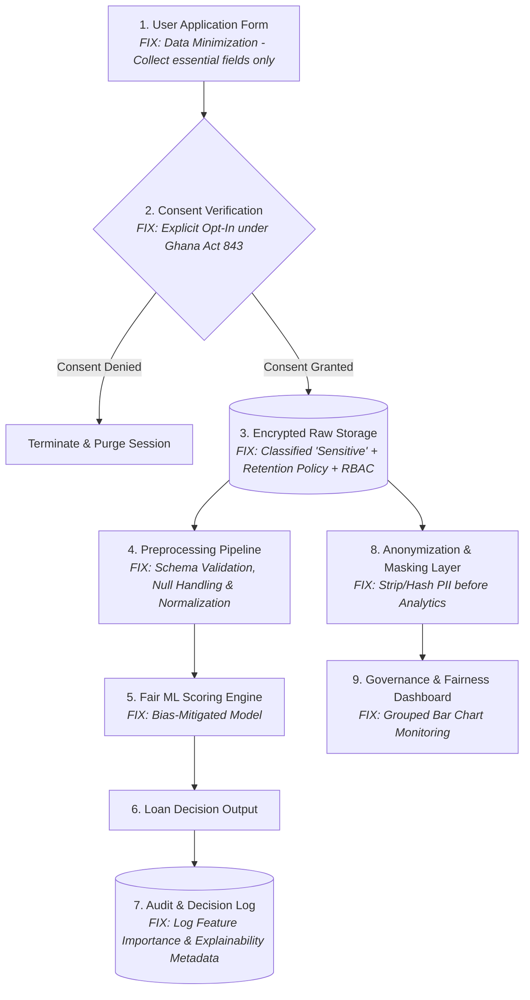

# Lab: Data Governance & Ethical AI Review — QuickLoan

## 1. QuickLoan Governance Review Card

| Section | Issue / Definition | Impact | Suggested Fix / Mitigation |
| :--- | :--- | :--- | :--- |
| **1. Data Quality Risk** | Incomplete and inconsistent customer data (e.g., missing income fields, inconsistent formats for phone numbers). | Leads to inaccurate ML predictions, model drift, and poor loan decisions. | Implement data validation rules at the input stage, enforce required fields, and standardize formats using automated preprocessing pipelines. |
| **2. Legal & Compliance Risk** | No explicit user consent obtained before collecting sensitive personal data. | Violates the **Ghana Data Protection Act, 2012 (Act 843)**, risking legal penalties, regulatory sanctions, and loss of customer trust. | Implement a clear consent management system with explicit opt-in checkboxes, timestamped audit logs, and apply **data minimization** principles. |
| **Data Classification** | **Sensitive / Confidential PII** (Personal Identifiable Information & Financial Records). | Unauthorized exposure of personal and financial data can cause severe financial and reputational harm to users. | Encrypt data at rest (AES-256) and in transit (TLS 1.3), restrict access, and enforce strict Role-Based Access Control (RBAC). |
| **3. Bias & Fairness Risk** | ML model trained on biased or incomplete demographic data. | Unfair loan approvals or disproportionate rejections for specific demographic groups. | Introduce pre-deployment fairness checks, continuously monitor model outputs across demographics, and retrain with balanced datasets. |
| **Source of Bias** | Historical lending data reflecting systemic socioeconomic inequalities and representation gaps. | Reinforces and automates historical discrimination patterns. | Utilize bias detection tools (e.g., Fairlearn, AIF360) and incorporate fairness constraints (e.g., demographic parity) during model training. |
| **4. Storytelling / Reporting Recommendation** | **Metric:** Approval Rate by Demographic Group ($\frac{\text{Approved Loans}}{\text{Total Applications}}$ per group). | Helps stakeholders quickly detect disparate impact and unfair treatment across applicant groups. | Track and report this metric monthly in governance dashboards alongside confidence intervals. |
| **Visualization Type** | **Grouped Bar Chart** (comparing approval rates across demographic categories). | Clearly highlights disparities between groups at a glance without distorting baselines. | Enables accessible monitoring and transparent executive/regulatory reporting. |
| **Why It Matters** | Ensures transparency, accountability, and fairness in automated credit decision-making. | Builds long-term customer trust and ensures ongoing regulatory compliance. | Supports sustainable, auditable, and ethical AI governance. |

---

## 2. Corrected Data Flow Diagram (Annotated Fixes)

The diagram below illustrates the remediated QuickLoan data pipeline, highlighting where governance controls have been injected to mitigate legal, quality, and ethical risks.

### Summary of Annotated Pipeline Fixes

* **Limit Data Collection (Step 1):** Restrict intake forms strictly to essential underwriting data (e.g., verified income, national ID, credit history).
  * *Governance Principle:* **Data Minimization** (reduces attack surface and compliance liability).
* **Add Consent Management (Step 2):** Introduce an explicit user consent verification gate and log consent timestamps before persisting any data.
  * *Governance Principle:* **Lawfulness & Consent** (ensures compliance with the *Ghana Data Protection Act, Act 843*).
* **Data Classification & Retention Policy (Step 3):** Tag all applicant records as *Sensitive*, enforce encryption/RBAC, and automate deletion schedules once loan obligations conclude.
  * *Governance Principle:* **Storage Limitation & Security** (prevents indefinite hoarding of PII).
* **Preprocessing Standards (Step 4):** Enforce strict schema validation, phone/currency standardization, and imputation rules prior to model inference.
  * *Governance Principle:* **Data Integrity & Quality** (prevents "garbage in, garbage out" predictions).
* **Decision Logging (Step 7):** Record all ML credit decisions alongside SHAP/LIME explanation metadata for every applicant.
  * *Governance Principle:* **Transparency & Auditability** (enables customers to contest decisions and auditors to review logic).
* **Data Masking & Anonymization (Step 8 & 9):** Mask or tokenize PII before routing data to BI tools, analytics teams, or third-party partners.
  * *Governance Principle:* **Privacy by Design** (protects user identity during downstream reporting).

---

## 3. Summary of Review Process

The review process focused on evaluating the QuickLoan data pipeline through the lens of core data governance frameworks—specifically the **data lifecycle** and **data classification** models. By auditing each stage from initial collection to storage, processing, and downstream reporting, critical vulnerabilities were isolated. For example, collecting non-essential personal attributes violated the principle of data minimization, while the absence of an explicit opt-in mechanism created a severe compliance gap under **Ghana's Data Protection Act (Act 843)**. Classifying applicant records as **Sensitive** established a clear baseline for enforcing encryption, role-based access controls (RBAC), and strict retention limits.

At the technical layer, data quality risks were traced to the lack of input validation and standardization prior to machine learning inference. Inconsistent formats and missing financial fields directly degraded model reliability, necessitating automated preprocessing gates. Furthermore, ethical risks were identified in the model's reliance on historical lending records, which risked encoding and amplifying existing socioeconomic disparities into automated rejections.

To operationalize ongoing ethical oversight, the **Approval Rate by Demographic Group** was selected as a primary fairness key performance indicator (KPI). Presenting this metric via a **Grouped Bar Chart** allows technical and non-technical stakeholders alike to immediately spot disparate impact across applicant segments. Together, these architectural and reporting interventions transform QuickLoan from an opaque, high-risk pipeline into an auditable, compliant, and fair lending system.